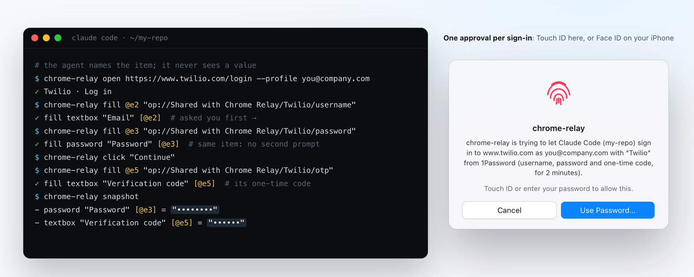
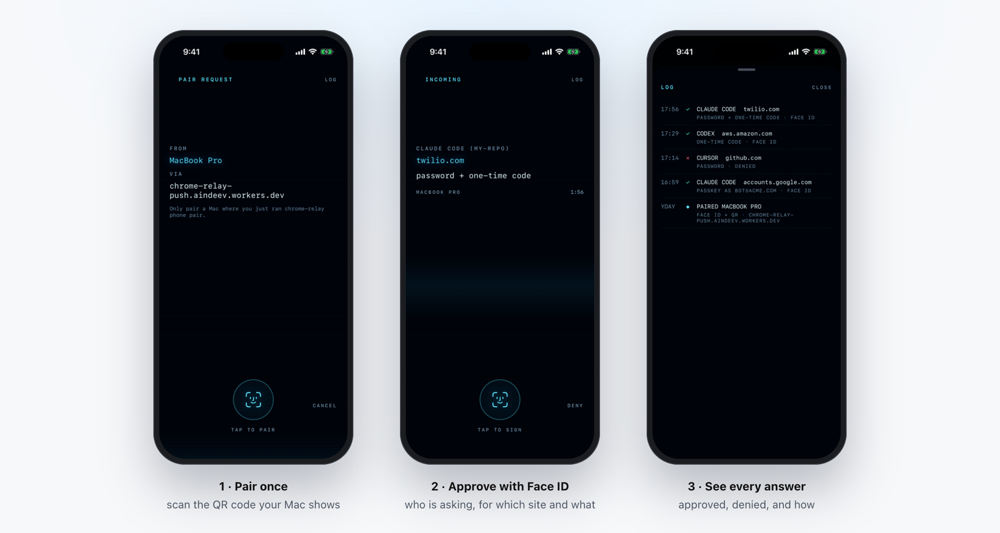

<p align="center"></p>

# Chrome Relay

<p align="center">
  <a href="https://agent-chrome-relay.aindeev.com"></a>
  <a href="https://read.aindeev.com"></a>
  <a href="https://x.com/AlexeyIndeev"></a>
  <a href="https://www.linkedin.com/in/alexey-indeev/"></a>
  <a href="LICENSE"></a>
</p>

<p align="center">
  <a href="https://testflight.apple.com/join/zhpm8gND"></a>
</p>

Lets your coding agents (Claude Code, Codex, Cursor, Paseo, pi) use **your everyday Chrome**, with your real
logins, from the command line, **in background tabs**: nothing takes focus, nothing on your screen moves.

- **Whole goals in one command.** `chrome-relay do "Invite the new teammate as an admin" --data "Email=ada@example.com"
  --until "text:Invitation sent"` fills, clicks and checks every step, in about the time an agent spends on one
  click. [More](#whole-goals-in-one-command-chrome-relay-do)
- **Or step by step**, with checked commands that answer in tens of milliseconds (`open`, `snapshot`, `click`,
  `fill`). [More](#step-by-step-chrome-relays-own-commands)
- **Sign-ins without you.** Google account hops are clicked through; other logins come from the 1Password vaults
  you share with it (passwords, 2-step codes, passkeys), typed by Chrome Relay so the agent never sees them.
  [More](#signing-in-with-1password-optional)
- **Approvals on your iPhone** when you're away from the Mac, with Face ID. [More](#approving-from-your-iphone)
- **An audit trail** of everything every agent did. [More](#audit-trail)

<p align="center"></p>

**Status**
- **Mac service:** built from source on your Mac ([Setup](#setup-once-per-mac-2-minutes), about 2 minutes).
- **Chrome extension:** [in the Chrome Web Store](https://chromewebstore.google.com/detail/mdglmmedlbkjphgolcejpphnbclkfnom)
  (unlisted: only at that link).
- **iPhone app**, Chrome Relay Approve: [on TestFlight](https://testflight.apple.com/join/zhpm8gND) (install
  TestFlight on the iPhone, then open the link there); in App Store review.
- **Password managers:** 1Password only, for now.

**The core** is background tabs with your logins, `chrome-relay do`, Google sign-in hops and an audit trail.
**Everything else is optional** and off until you turn it on: 1Password, Secure Enclave passkeys, iPhone
approvals, and a TypeSafe key for the fastest decider. See [What's optional](#whats-optional). Nothing installs
the extension for you, and it only runs on Macs whose owner set it up.

## How it works

```
chrome-relay open/click/fill/... ──unix socket /driver──┐
chrome-relay do ──────────────────unix socket /driver───┼──▶ relay (127.0.0.1:9333, LaunchAgent) ──ws──▶ Chrome Relay extension ──chrome.debugger──▶ agent tab
agent-browser (optional) ─────────ws (DevTools)─────────┘         ▲
   │                                                               └── reads the page and acts, in that agent's own tabs only
   └── do decides: saved flows → the agent's data → Jev or Haiku (Claude Code) → hand back to the agent
```

- **Extension** (`extension/`, MV3, one per Chrome profile you load it in): opens each agent tab **inactive**
  in a collapsed "Agents" tab group and runs DevTools commands in it via `chrome.debugger`. No remote-debugging
  port, so Chrome never shows "Allow remote debugging?". Chrome does show "Chrome Relay started debugging this
  browser" while agents work.
- **`chrome-relay`**: one Go program, **built and signed on your own Mac** (`./build`). As a background service
  (`chrome-relay serve`) it is the relay: a DevTools endpoint per agent, where each agent sees and controls only
  the tabs it opened and commands that could raise or focus the browser are swallowed. It is also the CLI
  (setup, the connection URL, `do`, diagnostics, audit trail), and the optional 1Password vault and passkeys, whose
  Secure Enclave and Touch ID code (`internal/macos`, Swift) is linked into the same signed binary when Xcode's
  command line tools are installed.

## Setup (once per Mac, ~2 minutes)

Fastest: paste [this prompt](https://agent-chrome-relay.aindeev.com/setup-prompt.txt) into Claude Code, Codex or
Cursor in its auto mode (Claude Code: Shift+Tab, or `claude --permission-mode auto`; Codex:
`--full-auto`) and let your agent do it. You only load the extension and approve in 1Password. By hand:

Needs macOS, Google Chrome and [Go](https://go.dev/dl/) 1.25+ (`brew install go`).

```bash
git clone https://github.com/aindeev/agent-chrome-relay
cd agent-chrome-relay
./build                    # compiles chrome-relay and signs it on this Mac (see below)
./chrome-relay setup       # secret, background service, identities, `chrome-relay` on PATH, Claude Code skill
```

**Why you build it yourself**: the binary is signed on your Mac, and macOS ties Chrome Relay's Keychain item to
that signature, so only your own build can read it (see the 1Password section). The build uses the hardened
runtime, so other programs can't attach a debugger to the relay or inject code into it. Two things make the
build fuller, and neither is required:

| You have | `./build` makes | |
|---|---|---|
| Go only | the **core**: tabs, Google sign-in hops, audit trail | passkeys you keep in 1Password still work (1Password's prompt) |
| + Xcode's command line tools (`xcode-select --install`) | the core **plus 1Password and Secure Enclave passkeys** | |
| + a code signing identity | the same, **signed by you** | without one it signs ad-hoc: macOS may ask once after each rebuild before Chrome Relay reads its own Keychain item |

Any Apple Development or Developer ID certificate is an identity (`security find-identity -v -p codesigning`
lists yours; a free one comes with an Apple ID in Xcode → Settings → Accounts → Manage Certificates). With
several, pick one with `./build --identity "<name>"`; it's remembered. `chrome-relay doctor` says which build
you have.

Then, **in each Chrome profile agents should use**: install **[Chrome Relay from the Chrome Web
Store](https://chromewebstore.google.com/detail/mdglmmedlbkjphgolcejpphnbclkfnom)** and **pin** it (puzzle-piece
icon → pin) so you see its badge. Check with `chrome-relay doctor`. Chrome keeps it up to date, and applies an
update once no agent tab is open.

Prefer your clone's own copy (to read every line that runs, or to change it)? Instead of the store's, never beside it:
open `chrome://extensions`, turn on **Developer mode**, **Load unpacked**, and pick the `extension` folder of your
clone. Both are the same code: the store's is `./package-extension` of this folder.

After `git pull`: `./build && chrome-relay update` (rebuilds, restarts the relay, reloads the extension in every
profile; the Web Store's copy checks the store instead).
To remove: `chrome-relay uninstall`, then remove the extension in each profile.

## Telling your agents

Claude Code: `setup` links the skill (`skill/SKILL.md`) into `~/.claude/skills/chrome-relay`, so every
repo gets it. Codex, Cursor and others: point them at the same file, e.g. a line in your global
`~/.codex/AGENTS.md`: *"For any browser step that needs my logins, follow
`<path>/agent-chrome-relay/skill/SKILL.md`."* A repo's `CLAUDE.md`/`AGENTS.md` only needs a
one-line pointer to the skill.

## Whole goals in one command: `chrome-relay do`

Driving a page one command at a time costs the agent a model round trip per click: the relay
answers in ~15 ms, the agent thinks for seconds. `chrome-relay do` lets the agent state the goal once, with the
values it already knows and how to tell it's done, and Chrome Relay carries it out in the agent's own tab:

```bash
chrome-relay do "Invite the new teammate as an admin" --url https://app.example.com/team/invite \
  --profile you@company.com --data "Email=ada@example.com" --data "Role=Admin" --until "text:Invitation sent"
```

Without `--url` it works in the tab the agent used last. Each step is the cheapest thing that works:

1. **A flow that worked before.** A run that ends with its `--until` checks met is saved per site
   (`~/.chrome-relay/flows/`, steps and data keys, never values); the same kind of goal there replays at browser
   speed, with the new data. `chrome-relay flows` lists them.
2. **The agent's data.** A `--data` key that names a field (`Email` → "E-mail address") fills it, picks the
   dropdown option or ticks the box, no model involved. Values can be `op://` references: the relay types them
   from 1Password as it does for a `fill`.
3. **A fast decision model** for the rest: TypeSafe's Jev (~0.15 s a step) if you saved a key
   (`pbpaste | chrome-relay decider jev`), else Claude Haiku through your own Claude Code (~1–1.5 s a step, on your
   Claude plan). It picks from a shortlist of the page's controls and from the agent's data only: it never invents
   text. The decider sees the shortlist, up to 1,500 characters of the page's visible text and the `--data` values
   (never `op://` references or what they hold).
4. **Back to the agent** (exit code 2), with what it did, the page it's on and the elements it was choosing
   between, whenever it isn't sure: a low-confidence decision, a field with no value, a click on a consequential
   button the goal doesn't name (delete, send, pay, deploy, authorize, ...; `--allow <verb>` permits it), a covered
   button, going in circles, leaving the site it started on, `--until` not met. "Done" is only trusted when
   `--until` holds.

Before every action the relay checks the element is still the one decided on, enabled, on screen and not
covered (open shadow roots included); after it, it waits for the page to settle (events, not polling) and reads
back what changed. That's what makes a step reliable without the agent looking again.

**Why this way.** The browser isn't the slow part: a command through the relay takes ~15–20 ms and a driven step
~10 ms, while real agents took a median 2.8 s between actions (p90 17 s), thinking. So `do` removes model round
trips rather than browser time. Measured in a real Chrome with Jev:

| Goal | How | Time |
|---|---|---|
| Fill and submit a 7-step order form | 3 fields from `--data`, 4 Jev decisions, the result checked | 2.5 s |
| The same goal, other data | replayed as a flow, no model | 1.2 s |
| Open a Wikipedia article through its search suggestions | 2 Jev decisions | 2.0 s |

**Which decider.** Next-action accuracy on 23 live steps / 150 Mind2Web steps, and the median time per decision
from a Mac:

| Decider | Live | Mind2Web | Per decision |
|---|---|---|---|
| TypeSafe Jev 1.13 | 91% | 67% | 0.15 s |
| Claude Haiku through Claude Code | 96% | 65% | 1.3–1.6 s |
| Cloudflare Clef (27B), Workers AI | 83% | 67% | 0.53 s |
| Gemini 3.8 Flash | 96% | 82% | 1.9 s |
| Local models under 1B | 9–30% | 14–19% | 0.2–0.5 s |

Jev is the default when you have a key, Haiku through Claude Code otherwise; small local models aren't accurate
enough yet. The method, caveats and the full table: [the approach](https://agent-chrome-relay.aindeev.com/approach.html).

Which decider runs: `chrome-relay decider` (and `doctor`). Every step is in the audit trail as `do click`,
`do fill` (the field, never the text), with `do start`/`do end` around the run.


## Step by step: Chrome Relay's own commands

For the steps `do` hands back, or when an agent wants to look as it goes, `chrome-relay` drives the page one
command at a time. Each agent has its own session (`CHROME_RELAY_SESSION=<name>`; Claude Code, Codex and Paseo
sessions are told apart on their own), and only sees the tabs it opened.

```bash
chrome-relay open <url> [--profile <email>] [--new]   # the first open starts the session; --new: another tab
chrome-relay snapshot [--text] [--json]               # controls with refs (@e5), and with --text the page's text
chrome-relay click | dblclick | hover <target>        # <target>: @e5, a whole label ("Save", button:Save), or CSS
chrome-relay fill <target> <text>                     # replace a field's text; op:// references from 1Password
chrome-relay type | select | check | uncheck | upload | drag | press | scroll | back | reload
chrome-relay get text|value|html|attr|count|url|title  # and: is visible|enabled|checked, eval, wait, screenshot, pdf
chrome-relay console | errors | cookies | dialog accept|dismiss | tabs | tab <id> | cdp <Domain.method>
chrome-relay click <target> --download [--into <dir>]  # and wait for the file it brings
chrome-relay downloads [--into <dir>] | save <url>... [--into <dir>]   # files; addresses loaded as the tab would
chrome-relay close [--all]
```

- **Selector counts.** `get count <css>` includes matches in open shadow roots and same-origin frames,
  the same roots as single-target selector commands. Other-origin frames stay outside that selector scope.

- **Every action is checked.** Before it: the control is still the one the agent saw, enabled, on screen and not
  covered (or about to hit another control inside it). After it: what changed, at once; the wait for the page to
  finish comes before the next step, usually while the agent is thinking.
- **It never guesses.** A label that matches two controls is refused with their refs; clicking needs the whole
  label ("Cancel" never clicks "Cancel subscription"); a ref from a page that's gone never names something on the
  next one.
- **The page can't steer it.** Its page scripts run in a script world of their own, so a site's JavaScript can't
  move where a click lands.
- **What it reads.** Snapshots see into open shadow roots, same-site frames and other sites' frames (a payment
  provider's card fields show as `in-frame (js.stripe.com)`), and list clickable elements without a role (a
  `<div>` with a click handler), file fields behind styled buttons, and radios hidden behind their labels.
- **Files come to the agent, not to Chrome.** A download, a PDF the page would show in Chrome's viewer, a file the
  page's script makes (a `blob:` export) and a popup that turns into a file (a blank popup the page sends to a
  signed link, as banks do) are saved by the relay, with no Downloads bubble and no viewer. Each action lists
  the files it brought; `--download` waits for them and `--into` puts them where you want. `save` loads
  addresses with the tab's cookies, so a list of links the page gave you becomes files without a script outside
  the browser.

Compared with [agent-browser](https://github.com/vercel-labs/agent-browser) through the same relay, on 23 test
pages that report whether the action really happened (`CHROME_RELAY_E2E=1 CHROME_RELAY_COMPARE=1 go test
./internal/cli -run TestCompareWithAgentBrowser`): Chrome Relay's commands 23, agent-browser 21. agent-browser
missed a `<div>` used as a button and a link that is only an image. Speed in a real Chrome (background tabs, median of five,
a local page, four runs):

| Command | agent-browser | chrome-relay |
|---|---|---|
| open a page | 42–54 ms | 49–69 ms |
| snapshot | 16–22 ms | 15–20 ms |
| fill | 14–23 ms | 21–26 ms |
| click | 19–25 ms | 27–29 ms |
| read the page's text | 12–17 ms | 13–18 ms |

The few milliseconds on fill and click are the check before the action and the read of what changed. What
agent-browser has that these commands don't: recording network traffic, traces and video, and page diffs. To use
it instead: `agent-browser --cdp "$(chrome-relay url you@company.com)" open <url>` (the URL
carries this Mac's secret: keep it out of logs and chats), then `agent-browser ...` as usual.

## Who can drive it

Two checks on every agent connection:

1. **This Mac's secret**: generated at setup in `~/.chrome-relay/token` (mode 600) and embedded in the URL
   that `chrome-relay url` prints.
2. **An allowed agent app**: the connecting process must come from Claude Code, Codex, Cursor or Paseo. The
   relay looks the process up (`lsof`, `ps`) and checks the markers those apps set in their child processes
   (`CLAUDECODE`, `CODEX_*`, `CURSOR_*`, `PASEO_AGENT_ID`), then its parent processes.

Connections that carry a browser `Origin` header (a web page) are refused even with the secret. Only **Chrome
Relay's extension** may connect as the extension: the Web Store's copy (its ID is the store's, which no other
extension can have) or **this checkout's** unpacked copy (for the unpacked one, Chrome derives the ID from its
folder; `setup` records it in `~/.chrome-relay/config.json`). The relay checks the connection's `Origin:
chrome-extension://<id>` (which pages cannot fake), and the connecting process must be Chrome. Trusting the store's
copy means trusting its releases: each is `./package-extension` of a commit in this repo, and Google reviews it
before it ships. Load your clone's copy instead if you'd rather trust only code you pulled.

This keeps other local tools, web pages and accidents out. It is not a boundary against malware already
running as you, which could read the secret and fake the markers.

## Sign-ins

Agents sign in on their own, so a task doesn't stop at a login page. When a site bounces through Google and the
right account is **already signed in**, the extension clicks the account and **Continue/Allow** itself (page
scripting, so it works even with 1Password's frame on the page). Otherwise the agent fills the login from the
1Password vaults you shared (below): username, password and 2-step code, including codes split over one box per
digit. A code or link the site sends by email, it reads from your mail and types or opens itself, and it ticks
"remember this device". Only when none of that works (no login in the vault, a passkey only 1Password holds)
does it ask you, saying what it needs.

Which Google account a site uses comes from `~/.chrome-relay/identities.json` (`chrome-relay identities`):
your Chrome profiles (filled in by setup), optional hand-set `sites.rules`, and `sites.learned`, which the
relay fills in after each successful hop. Default: the profile's own account.

## What's optional

Nothing below happens unless you set it up, and each part can be turned off again:

| Feature | Default | Turn on | Turn off |
|---|---|---|---|
| Background tabs, Google sign-in hops, audit trail | on | `./chrome-relay setup` | `chrome-relay uninstall` |
| Signing in with 1Password (passwords, 2-step codes), and saving the logins agents create | **off** | `chrome-relay vault setup` | `chrome-relay vault forget` |
| Passkeys in agent tabs | on: 1Password's own prompt answers, or Chrome Relay's Secure Enclave passkeys if you have 1Password set up | `chrome-relay passkeys on` | `chrome-relay passkeys off` |
| Approving on your iPhone (Face ID), when away from the Mac | **off** | `chrome-relay phone pair` | `chrome-relay phone forget` |
| Notifications when an agent needs you (a passkey only you can approve in 1Password) | on once you allow them | `chrome-relay notify test`, then allow | System Settings > Notifications > Chrome Relay |
| One approval for several passkey sign-ins | **off** (every signature asks) | `chrome-relay passkeys reuse 120` (1–300 s) | `chrome-relay passkeys reuse off` |
| A fast decider for `chrome-relay do` (TypeSafe's Jev; page text of agent tabs then goes to TypeSafe) | **off**; Haiku through your Claude Code if it's installed | `pbpaste \| chrome-relay decider jev` | `chrome-relay decider jev forget` |

The notifications come from *Chrome Relay.app*, a small app `./build` makes and `setup` puts in `~/Applications`
(it needs Xcode's command line tools). It exists because Chrome's own notifications are often switched off in
macOS, and the extension's toolbar badge only shows while the extension is pinned. Clicking one opens the tab
that needs you. A Focus (Do Not Disturb) hides them unless you let Chrome Relay through.

With passkeys off, agent tabs leave pages' WebAuthn alone (Chrome then refuses it in background tabs, as it
would anyway). With no vault set up, the relay never talks to 1Password, prompts for nothing and stores no
token.

## Signing in with 1Password (optional)

Needs a build with Xcode's command line tools (see Setup).

Agents can sign in with logins from 1Password: passwords, 2-step codes (TOTP) and passkeys. They never see a
value: they name an item, and the relay types the value into the page, only on that item's website.

```bash
chrome-relay vault setup     # asks which 1Password accounts, then makes a shared vault and a service account in each
chrome-relay vault           # what agents can see: vaults, titles, websites, usernames, what each item holds
```

**Through 1Password service accounts.** `chrome-relay vault setup` lists the 1Password accounts on this Mac and
asks which agents may use: one, several (say personal and work) or all. In each it creates a shared vault if
there isn't one ("Shared with Chrome Relay (personal)", "… (acme)": the names must differ, since agents name vaults
only by name), and a [service account](https://developer.1password.com/docs/service-accounts/) that can read and
write **that vault only**, using your [1Password CLI](https://developer.1password.com/docs/cli/) (1Password asks
you to approve once). Each token goes straight into this Mac's Keychain, never on screen. It tells you what it
made; see or revoke it on 1Password.com (Developer > Directory > Service Accounts). Then move or copy into those
vaults the logins agents may use. Service accounts work in the background and while you're away, with no
1Password prompts after setup. 1Password never lets a service account into a Private vault, which is why agents
get their own. One account without questions: `vault setup <vault> --account <email>`; a service account you made
yourself: `--paste` takes its token.

Agents fill a field with a [secret reference](https://developer.1password.com/docs/cli/secret-reference-syntax/)
and the relay types the real value:

```bash
why="Download March's invoice for the books"
chrome-relay fill @e2 "op://Shared with Chrome Relay/Twilio/username" --why "$why"
chrome-relay fill @e3 "op://Shared with Chrome Relay/Twilio/password" --why "$why"
chrome-relay fill @e7 "op://Shared with Chrome Relay/Twilio/otp" --why "$why"   # the current one-time code, from the item's TOTP secret
```

- **Which account.** You may have several logins for one site (three Twilio items, say). The relay never picks:
  the agent names the item, choosing by the vault, title and username `chrome-relay vault` shows it, and asks you
  when your request doesn't say which.
- **Chrome Relay asks too, with the details.** Its own approval names the agent, item and site, on Touch ID here
  and, if you paired one, Face ID on your iPhone at the same time (first answer wins; see below): *"let Claude Code
  (my-repo) sign in to www.twilio.com as you@company.com with "Twilio" from 1Password. It says why: “Download
  March's invoice for the books”"*. The why is the agent's own sentence, quoted as such (`--why`, required with a
  reference; `chrome-relay do` uses its goal): Chrome Relay checks the site and the account, not the reason, and
  says so when an agent gave none. How often is yours: **every
  sign-in** (the default: one approval lets that agent use that item for two minutes: its username, password and
  one-time code, on any of the item's websites), **once per agent session** (one approval, naming the vaults, covers
  that agent's sign-ins until it disconnects), or **never**. Change it with `chrome-relay vault approve
  sign-in|session|off`, which asks you first. Decline anything you didn't expect.
- **Only the item's site.** A value is typed only into a page whose host is the item's website or a subdomain of it,
  over https (or `localhost`), in the page itself or a frame of the page's own origin (Apple's sign-in form; the
  page's script reaches into those anyway), never another site's frame, like 1Password's own filling. References to
  any other vault are refused.
- **Secrets only into password fields**, so they show as dots on screen and in the agent's snapshots. If the
  agent (or the page) reads a filled secret back, the relay masks it in everything it sends the agent.
- **Saving what agents create.** When an agent signs up for something or turns on 2-step verification for you,
  it fills a reference ending in `?new` (`op://Shared with Chrome Relay/Acme/password?new&username=bot@acme.com`,
  `op://Shared with Chrome Relay/Acme/otp?new`). Chrome Relay generates the password, or reads the 2-step setup key
  from the page (its QR code or the key in text), saves it in 1Password, and types it, after you approve the save.
  The agent never sees either. New logins are Login items tagged `chrome-relay-saved`; a 2-step key for a login of
  yours goes into a separate item beside it, since Chrome Relay never changes your items.
- **Audited.** Every fill, refusal, passkey creation and passkey sign-in is in `chrome-relay audit` (item and
  field names, never values).
- **Signing.** The hardened runtime with library validation on: no library signed by anyone else loads into
  `chrome-relay`, and debuggers and `DYLD_*` injection are blocked. (The 1Password SDK compiles WebAssembly, the
  one exception: `allow-unsigned-executable-memory`.)

**Where the service account tokens live.** In your login Keychain (items *Chrome Relay*, one per account), in
two layers:

1. **Only your signed `chrome-relay` reads the item.** It creates the item itself, so macOS ties it to the
   binary's signature: any other program that asks (`security`, a script, an agent) gets macOS's *"… wants to
   access 'Chrome Relay' in your keychain"* dialog, and nothing unless you allow it. (Most command-line tools,
   Claude Code's and Codex's own logins included, store theirs through Apple's `security` tool, which every
   program on your Mac can run silently. Chrome Relay deliberately doesn't.)
2. **What's in the item is locked to this Mac's Secure Enclave.** Even a program you let through gets only
   ciphertext that opens on this Mac alone. Opening it asks you nothing (after `vault setup`, no Touch ID for
   the token ever); each sign-in is approved instead, as often as you chose. That choice is kept in the same
   item, not in `config.json`, so nothing an agent can edit switches approvals off: change it with
   `chrome-relay vault approve session|sign-in|off`, which asks you first.

The relay talks to 1Password in-process (no `op` command, so the token never sits in another process's
environment), keeps the token in memory only while it runs, and is built with the hardened runtime, so no
debugger can attach to it. `chrome-relay vault forget` removes the item. One thing this can't change: an agent
can always *use* the relay as intended, filling a site's password into that site, where page script could read
it. So keep in the vault only accounts you're happy for agents to use, and give the service account an expiry.

### Passkeys

- **In this Mac's Secure Enclave.** Chrome won't run WebAuthn in a background tab, and 1Password's passkey
  prompt would knock the debugger off the page, so agent tabs hand `navigator.credentials.create/get` to the relay,
  which acts as the authenticator (ES256, no attestation). The keys are made by the Mac's **Secure Enclave** and
  never leave it: `chrome-relay` asks the chip to create a key or sign. Neither the relay, the vault nor the agent
  ever holds a private key, and the chip's handle for a key stays in Chrome Relay's own Keychain item, so only
  your `chrome-relay`, on this Mac, can use it.
- **Every sign-in needs your approval**, Touch ID here or Face ID on your paired iPhone, saying who is asking,
  for which site and account: *"chrome-relay is trying to let Claude Code (my-repo) sign in to github.com as
  bot@company.com, from github.com. It says why: “Merge the release PR you approved”"* (the agent's last `--why`
  from the past 10 minutes). If an agent signs in to many sites in a row, `chrome-relay passkeys reuse
  120` lets one approval cover **that agent's** passkey sign-ins for 2 minutes (up to 300 seconds; the prompt
  says so; other agents still ask). Off by default.
- **Creating one.** A site's "Create a passkey" (only right after the agent clicked or typed in the page, and
  while the Mac is unlocked) stores the public key in an item of its own (*"GitHub passkey (you) · Chrome Relay ·
  Sam's MacBook Pro"*, tagged `chrome-relay-passkey`), in the vault that holds the site's login for that
  username, so a work account's passkey stays in the work account. Chrome Relay never changes your own items:
  the only items it edits are the ones it made.
- **Each Mac keeps its own.** A passkey's key is in one Mac's Secure Enclave, so its item records which Mac (its
  name, and an ID derived from its hardware UUID). Other Macs sharing the vaults neither use nor replace it: give
  an account a passkey on each Mac you use. Passkeys made by an older Chrome Relay keep asking for Touch ID on the
  Mac itself.
- **Your own 1Password passkeys** (your Google passkey, say) never leave 1Password: no program can read them.
  When a page asks for a passkey the relay doesn't hold, the request goes to 1Password's own prompt in the
  agent's tab, and you approve it. Chrome Relay notifies you, and its toolbar icon shows a red **key** badge.
  Clicking either opens that tab (the only time an agent tab comes forward, and only on your click). The tab
  waits up to 5 minutes, and the agent is told `PASSKEY APPROVAL NEEDED` so it can ask you. This works with no
  vault set up at all.
- **Giving an account a Chrome Relay passkey.** Ask your agent ("add a Chrome Relay passkey to my Google
  account"). It opens the site's passkey settings, you approve the site's "verify it's you" step, and it
  clicks "Create a passkey". From then on that account signs in with only your approval, wherever you are.
  The skill has the steps.

### Paying with a card

A 1Password Credit Card item pays at checkouts: `chrome-relay fill @eN "op://<vault>/<card>/number" --why "..."` (also `expiry`,
`expiry-month`, `expiry-year`, `cvc`, `name`). A card has no website, so the relay decides where it goes: only into
the matching card field of the checkout page itself (https) or of a payment provider's frame in it (Stripe,
Braintree, Adyen, Checkout.com, Square, PayPal and a few more), never another site's frame. Every payment asks you,
naming the agent, the shop and the card's last four digits, whatever you chose for sign-ins; one approval covers
that card's fields on that site for two minutes. Card fields read back as filled, never their contents; after a card
fill the tab takes no screenshots until the page moves on; and the audit trail records only the last four.

### Approving from your iPhone

<p align="center"></p>

When you're away from the Mac, a paired iPhone can approve instead: `chrome-relay phone pair` (after Touch ID)
shows a QR code; scan it with the iPhone's Camera and open it in *Chrome Relay Approve* ([join the beta on
TestFlight](https://testflight.apple.com/join/zhpm8gND), or build it from `ios/` with `./ios/build`; `./ios/release`
sends your own build to TestFlight). From then on every approval goes to Touch ID here and to the iPhone at once, and
the first answer wins. The iPhone shows the Mac, the agent, what it asks and why it says it needs it (its own
sentence, quoted; "no reason given" when it gave none), and approves with Face ID: its key
for that lives in the iPhone's Secure Enclave, and the Mac checks the signature against the key it paired with,
so nothing in between can approve.

**What sits between the Mac and the phone.** One small [relay](push-relay/README.md) (a Cloudflare Worker), for
two things the devices can't do directly. It carries the messages: neither device can accept a connection from the
other, so each posts sealed messages there and fetches the other's; the relay holds ciphertext for up to 12 hours
and can't open it. And it wakes the phone: only Apple can put a notification on a locked iPhone, and it accepts a
push for an app only when signed with that app's developer key, which the relay holds so that not every Mac has to;
it shows a fixed *"An agent is waiting for your approval."* The relay can't approve anything, and you can do
without it: `chrome-relay phone pair --server` takes any [ntfy](https://ntfy.sh) server, `chrome-relay phone push
--key …` uses your own Apple key, and `CHROME_RELAY_PUSH_RELAY=off` turns the relay off. `chrome-relay phone`
shows what is in use.

## Moving to S4 Code

S4 Code has Chrome Relay built in. Its **Settings > Chrome > Import from
Chrome Relay** takes over this install's passkeys and 1Password access, so nothing has to be made again: no new
passkeys, no second vault. It runs `chrome-relay export --for s4` itself, which asks for Touch ID (*"chrome-relay is
trying to Move Chrome Relay's passkeys and 1Password access to S4 Code"*) and then prints one JSON object for S4
Code to read: the Secure Enclave handles of the passkeys Chrome Relay made on this Mac (the keys themselves never
leave the chip, and a handle works only on this Mac), each service account with its token and how often it asks,
the passkey settings, the TypeSafe key and the flows `do` learned. It changes nothing here, in the Keychain or in
1Password, so Chrome Relay keeps working afterwards. It won't print to a terminal, since its output holds secrets.

## Audit trail

Every agent action is recorded in `~/.chrome-relay/audit/YYYY-MM-DD.jsonl`; read it with `chrome-relay audit`: who
connected (app, Claude/Paseo session id, working folder, `CHROME_RELAY_SESSION` or `AGENT_BROWSER_SESSION`), pages,
clicks with positions, special keys, the agent's own scripts, screenshots, uploads, popups, sign-in clicks and
blocked pages. Typed text is stored only as a character count, and URLs lose their query string.

## Behaviour worth knowing

- **Popups and `target=_blank` links** open as new hidden tabs owned by the same agent; popup sign-in flows
  that `postMessage` back to the opener and close themselves keep working. Message origins are the ones the relay
  saw each tab load (never what the page claims), and `targetOrigin` is enforced. A safety net adopts any tab an agent
  page opens anyway and hands focus back to the tab you were on.
- **1Password and other password managers** stay out of agent tabs: their fields are marked `data-1p-ignore`
  (and the LastPass and Bitwarden equivalents), because Chrome drops an extension's debugger from a page that
  contains another extension's frame (1Password's inline menu). If a frame gets in anyway, the agent's commands
  wait while the extension re-attaches.
- **Self-cleaning**: tabs of an agent silent for 30 minutes are closed. When the relay restarts, the extension
  closes the agent tabs it opened (tracked by tab id, so your own tab groups are never touched).
- **Real input in background tabs**: focus emulation is on in every agent tab, so clicks and typing land.
- **Files** (tabs of `chrome-relay open` sessions; agent-browser connections keep Chrome's own downloads): the relay
  looks at each page's response headers (DevTools `Fetch`, which is therefore not available to `cdp` there).
  An attachment, or in the tab's own frame a type Chrome wouldn't show as a page (PDF, CSV, zip, ...), is
  streamed into `~/.chrome-relay/downloads/<session>/` and its navigation cancelled, so the page stays where it
  was and a popup opened only for the file closes, as Chrome does with downloads. Same-site `<a download>` links
  and `blob:`/`data:` files are read in the page. Only within a minute of the agent's own click, key or open: a
  file a page starts on its own is refused. Names come from the site, cleaned (no paths, hidden files or
  right-to-left tricks), never overwrite, and get macOS's quarantine flag. Files are deleted when the session
  ends; the audit trail records each one (name, size, address without its query).

## Development

**Dev mode**: try a branch beside your normal install. From a second checkout (e.g. a git worktree):
`./build && ./chrome-relay setup --dev` installs `chrome-relay-dev-mode`, with its own relay (port 9334, written to the
checkout's `extension/relay.json`), data folder `~/.chrome-relay-dev-mode`, background service and Keychain
item; it leaves your agents' skill alone. Load that checkout's `extension` folder unpacked as a second Chrome
Relay (its tooltip says dev mode), and point agents at `chrome-relay-dev-mode url <email>`. Remove it with
`chrome-relay-dev-mode uninstall`.

```bash
go generate ./internal/macos            # the Swift Secure Enclave / Keychain / Touch ID layer (./build does this too)
CGO_LDFLAGS="-L$(xcrun --show-sdk-path)/usr/lib/swift -L$(dirname $(xcrun -f swiftc))/../lib/swift/macosx" \
  go test -race ./...                   # relay, CLI, 1Password fills, passkeys (in-memory 1Password and chip stand in)
CGO_ENABLED=0 go test ./...             # the core-only build (also what runs on Linux)
CHROME_RELAY_E2E=1 go test ./internal/cli -run TestDo   # `chrome-relay do` against real pages in a throwaway headless Chrome
                                        # (+ CHROME_RELAY_E2E_CLAUDE=1, or CHROME_RELAY_E2E_JEV=1 with TYPESAFE_API_KEY: real deciders)
node --test test/extension-*.test.mjs   # the extension's service worker
node --test test/push-relay.test.mjs    # the push relay (push-relay/)
```

Logs: `chrome-relay logs` (`~/.chrome-relay/relay.log`). Testing extension changes: edit `extension/`, then
`chrome-relay update`. `CHROME_RELAY_HOME` and `CHROME_RELAY_PORT` override the data folder and port.

**Releasing the extension** to the Chrome Web Store (unlisted, published by Alexey Indeev): raise `version` in
`extension/manifest.json`, `./package-extension`, and upload the zip in the
[developer dashboard](https://chrome.google.com/webstore/devconsole) (Chrome Relay → Package → Upload new package →
Submit for review). Installs update on their own a few hours after it's approved. The listing text, permission
justifications and images are in [`store/`](store/). Keep the extension's protocol compatible both ways: an install's
relay and its store extension are updated separately, and `doctor` only flags an extension newer than the relay.

## About the author

Made by **Alexey Indeev**, co-founder and CTO of [Spare](https://sparelabs.com). I write about building more
with AI, whether you code or not, at **[The Leveraged Mind](https://read.aindeev.com)**.

- Blog: https://read.aindeev.com
- X: [@AlexeyIndeev](https://x.com/AlexeyIndeev)
- LinkedIn: https://www.linkedin.com/in/alexey-indeev/
- GitHub: [@aindeev](https://github.com/aindeev)

Questions, ideas or bugs: open an [issue](https://github.com/aindeev/agent-chrome-relay/issues) or reach out on X.

## License

MIT. See [LICENSE](LICENSE). Code adapted from other projects: [THIRD-PARTY-NOTICES.md](THIRD-PARTY-NOTICES.md).
